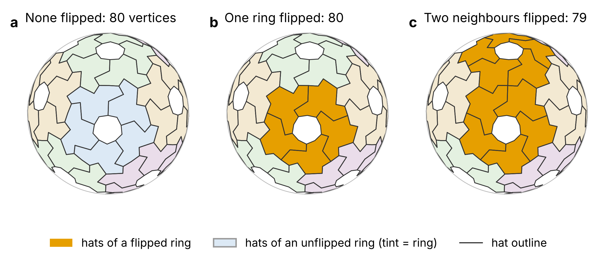
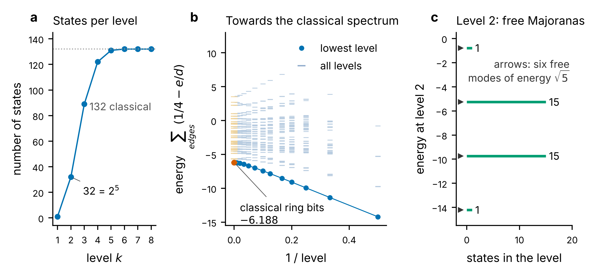
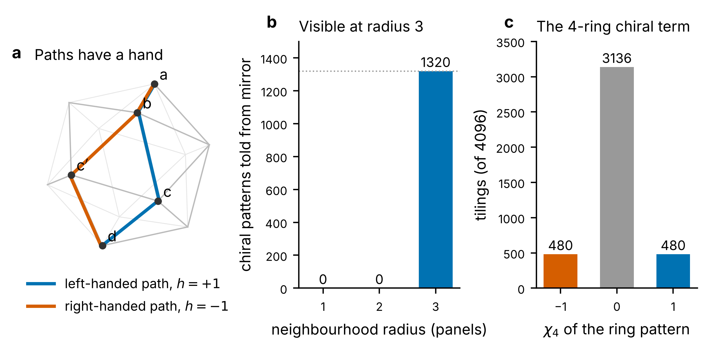

# Hat time: ring bits, quantisation levels, and two kinds of handedness

This note collects what was found on the Hat Trick ball (60 hats and 12 pentagons on the 92-tile geodesic sphere) between the ribbon result of Stage 3 and Stage 9c of [`ROADMAP_QUANTUM_GRAVITY.md`](ROADMAP_QUANTUM_GRAVITY.md). The roadmap has the full numbers; this note gives the argument in order, with figures.

Labels, as in the roadmap: **Exact** (an identity checked to rounding, or an exhaustive count), **Counted** (a finite sample or a numerical search), **Known** (a standard result used but not derived here), **Definition** (a choice of ours), **Not done**.

Scripts: `hat_flips.py`, `ring_bits.py`, `qdeform_punctures.py`, `hat_chirality.py`, `spectre_fold_flips.py`; figures by `make_hat_time_figures.py`. They need [`brentharts/hexasphere`](https://github.com/brentharts/hexasphere) (and `spectre_fold_flips.py` needs [`brentharts/ballgen`](https://github.com/brentharts/ballgen)) as sibling folders.

## Summary

1. In the plane, a flip of the Spectre tiling is an open ribbon. On the Hat Trick ball every flip is closed, and there are exactly 12 of them: the ring of 5 hats around each pentagon has two tilings. The ball has exactly 2^12 = 4096 hat tilings, one bit per cone point.
2. Read as spins, the 12 bits contain the 132-dimensional space of a sphere with 12 spin-1/2 punctures, and the geometric vertex count becomes the Heisenberg model on the icosahedron there.
3. That model is the large-level limit of a one-parameter family (the skein quantisation used by Asselmeyer-Maluga and Krol for wild embeddings). At level 2 it is a free Majorana model with the same flux through every face.
4. The hat has a hand, and the ring bits see it: the first mirror-odd term involves 4 rings on a helical path. But this handedness cannot fix the sign of the flux, because the hat breaks mirror symmetry only, and the flux needs time reversal broken as well.

## 1. Twelve ring bits

*Figure 1. The Hat Trick ball seen from above one pentagon (white holes are the 12 pentagons). Tints mark the rings of 5 hats; orange hats belong to a flipped ring. (a) The icosahedral tiling. (b) The central ring re-tiled in its second way: the outline of the ring is unchanged, the five hats inside are cut differently, and the number of vertices of the hat complex stays 80. (c) A neighbouring ring flipped as well: one vertex is lost.*

- **Exact (`hat_flips.py`, 4 tests).** Removing any connected cluster of up to 7 hats and re-tiling it gives only 12 flips: the ring of 5 hats around a pentagon (40 kites, an annulus) has exactly two tilings.
- **Exact.** The 12 rings are disjoint and cover the ball. An exhaustive exact cover of all 480 kites finds 4096 tilings, and they are exactly the 2^12 ring states.
- **Exact.** The number of vertices of the hat complex is `V = 80 - (number of icosahedron edges whose two rings are both flipped)`, for all 4096 tilings.

So on this sphere a flip is a closed ribbon around a cone point, and the configuration space is one bit per cone point. In the plane (Stage 3) no closed flip was found. On closed Spectre folds, second tilings were found for small clusters that contain a cone point (151 of 1079 clusters of 2 to 4 tiles) and none for clusters without one; that search misses some tilings, so only the positive count is a result (`spectre_fold_flips.py`, **Counted**).

## 2. The bits as punctures

- **Exact (`ring_bits.py`).** The 60 rotations permute the bits and flip none.
- **Definition.** Read a ring bit as a spin-1/2 at its cone point.
- **Exact.** The gauge-invariant space of 12 spin-1/2 punctures (the 132 singlets of Stage 9b) then lies in the span of the tilings, on the 924 tilings with 6 rings flipped.
- **Exact.** The vertex count does not commute with total spin, and its projection onto the singlets is `72.5 - (1/3) sum over edges of S_i.S_j`: the Heisenberg model on the icosahedron. Its lowest level is `sum S_i.S_j = -6.1879`, unique.

A quantum Hamiltonian appears without a transverse field put in by hand: it comes from a geometric count and gauge invariance. Which sign of `V` is the energy is not fixed by anything here.

## 3. Quantisation levels

The source for this step is Asselmeyer-Maluga and Krol, [arXiv:1211.3012](https://arxiv.org/abs/1211.3012). Their claim is that a wild embedding (Alexander's horned ball) is the quantisation of a tame one. The quantisation they use is the Kauffman bracket skein algebra of curves, which for a disc with marked points is the Temperley-Lieb algebra. In that paper the skein and Temperley-Lieb steps are cited theorems, the step from the horned ball to marked points is by analogy, and the general statement is a conjecture. It says nothing about tilings.

What connects is the algebra. Our 132 singlets are the non-crossing pairings of 12 points, a Temperley-Lieb module at loop value `d = 2`, and `S_i.S_j = 1/4 - e_ij/2`. Applying the same quantisation to our 12 punctures (`qdeform_punctures.py`, 6 tests):

*Figure 2. (a) Dimension of the state space at level k: 1, 32, 89, 122, 131, then 132. (b) All energy levels against 1/k (blue dots: lowest level), tending to the classical spectrum at 1/k = 0 (orange). (c) The four levels at k = 2 with their degeneracies; arrows are the free-fermion prediction.*

- **Exact.** At level `k` (`d = 2 cos(pi/(k+2))`) the state space has dimension 1, 32, 89, 122, 131 for `k` = 1 to 5 and 132 from `k` = 6 on, equal to the standard count of conformal blocks.
- **Definition.** `H_k = sum over edges of (1/4 - e_ij/d)`; at `d = 2` this is `sum S_i.S_j`.
- **Exact.** The lowest level is unique at every level and moves from -14.208 (`k` = 2) through -8.525 (`k` = 6) and -6.668 (`k` = 20) to the classical -6.18789. The result does not depend on the order chosen for the punctures.

### Level 2

- **Exact.** On the 32 states the operators `Gamma_ij = 2 e_ij/d - 1` square to 1, anticommute when two edges share a cone point and commute otherwise. So `Gamma_ij = i s_ij g_i g_j` with one Majorana operator `g_i` per cone point.
- **Exact.** The product of the three `Gamma` around each of the 20 faces is the same, `+i` or `-i`. The signed adjacency matrix `a` has `a^2 = -5`, so all six fermion modes have energy `sqrt 5`, and the levels are `-7.5 + (sqrt 5 / 2)(6 - 2m)` for even `m`: -14.208, -9.736, -5.264, -0.792 with 1, 15, 15, 1 states.
- **Known.** 32 = 2^5 is the space of 12 Ising anyons. The five qubits sit on pairs of neighbouring cone points: six disjoint edges give six commuting `Gamma` whose product is 1.
- A single ring flip has no level-2 form: one `g_i` changes the fermion parity, just as one `X_i` is not gauge invariant classically.

## 4. Two kinds of handedness

### The sign of the flux is an orientation convention

**Exact (test 6).** With a fixed convention (the arc of an edge passes over the strands on the left of the puncture order, seen from outside) the face flux is `-i` for either order of the punctures and either direction. It changes sign under exchange of over and under, and under `A -> 1/A`. Nothing else enters.

### The hat's hand is visible in the bits

*Figure 3. (a) Two paths of three edges from a vertex a of the icosahedron to its antipode d, through the same b: one turns left at b (blue), one right (orange). (b) Number of chiral ring patterns (of 1320) whose tiling can be told from that of the mirror pattern, by counting panels according to their surroundings out to 1, 2 or 3 neighbours. (c) Values of the 4-ring term over all 4096 tilings.*

All 4096 tilings use one hand of the hat. A reflection of the icosahedron permutes the bits; the tiling of the mirrored pattern is again made of hats of the same hand, so it need not be the mirror image of the original tiling.

- **Counted (`hat_chirality.py`).** 1320 of the 4096 patterns are chiral (no rotation takes them to their mirror pattern). For all 1320 the two tilings differ as cell complexes: an orientation-blind hash of the panel graph, which separates exactly the 96 rotation classes, is different.
- **Counted.** Counts of panels by their surroundings out to second neighbours are mirror symmetric for every pattern. Out to third neighbours, 93 of 124 counts have a mirror-odd part; these parts span 6 dimensions and, as polynomials in the bits, start at order 4.
- **Counted.** The simplest such term is

  `chi4 = sum over helical paths of h n_a n_b n_c n_d`,

  where `a-b-c-d` is a path of three edges from a vertex to its antipode and `h = +1` or `-1` as the path turns left or right at `b`. It is the whole order-4 mirror-odd part of 15 of the counts; 54 start at order 5 or 6, and 24 also contain a second order-4 shape.

The vertex count `V`, which gave the Hamiltonian, is mirror symmetric. So are the counts of shared sides, vertex types and hat degrees.

### Why the hand cannot fix the flux

| quantity | reflection | complex conjugation |
|---|---|---|
| vertex count `V`, Heisenberg model | even | even |
| `chi4` and every other function of the tiling | odd | even |
| face flux at level `k` | odd | odd |

A function of the tiling is real in the tiling basis. So the hat's hand is odd under reflection and even under complex conjugation, which is time reversal here. The flux is odd under both: `A -> 1/A` is complex conjugation of the level-`k` operators. A term that is odd under reflection alone cannot couple linearly to a quantity that is odd under both.

So there are two independent handedness choices in this model. The tiling makes the first one (which hand of hat). The second one, the sign of the level, is what breaks time reversal, and the tiling does not make it. This is a symmetry argument. `chi4` has not been built as an operator on the 132 singlets or on the 32 level-2 states.

## What this does not show

- No wild embedding and no 4-dimensional structure. The 12 cone points are tame; a Cantor set in a surface is always tame.
- Nothing selects a level `k`.
- The type II_1 limit of the Temperley-Lieb tower needs cone points at more and more scales. The Hat Trick ball has 12, and Stage 10a found no hat tilings on the other spheres tested.
- Reading a ring bit as a spin is a definition.
- The Spectre is also one-handed. Whether its closed folds give a term like `chi4` is not tested.

## Reproduce

    python3 hat_flips.py 5 --tests          # 12 ring flips, 4096 tilings, the vertex rule
    python3 ring_bits.py --tests            # bits as punctures, Heisenberg form
    python3 qdeform_punctures.py            # levels k, level-2 Majorana model, flux convention (6 tests)
    python3 hat_chirality.py                # 1320 chiral patterns
    python3 hat_chirality.py --chi4         # the 4-ring term (also runs the line above)
    python3 make_hat_time_figures.py        # the three figures
