# Tri-Spectre Quantum Network

**A Coupled Multi-Scale Quantum Simulator Built on Chiral Aperiodic Einstein Monotiles**

This project connects a matrix-free, functional quantum state simulator (`State`) with an editable geometric object model of the curved **Einstein Spectre monotile** (`spectremodel.py`) to create a network of three entangled quantum computers at substitution scales of **9**, **71**, and **559** tiles.

---

## Why This Project Is Unique & Interesting

1. **Aperiodic Quasi-Crystal Topology Instead of Rigid Square Grids**
   Most quantum computing architectures assume periodic 2D lattices (such as square heavy-hex or surface-code grids). Here, qubits live on the **bump-and-dent pairs** of **Einstein Spectre monotiles**—14-sided chiral tiles that tile the plane aperiodically without translational symmetry. This creates non-repeating local neighborhoods and hierarchical scale self-similarity across generations.

2. **Substitution Recurrence as Multi-Scale Quantum Hardware ($71 \to 559 \to 4401$ tiles)**
   Under the Spectre substitution system, single Spectres and 2-tile clusters (*Mystics*) inflate according to:
   * $\text{Mystic} \mapsto 1\,\text{Mystic} + 6\,\text{Singles}$ ($8$ tiles)
   * $\text{Single} \mapsto 1\,\text{Mystic} + 7\,\text{Singles}$ ($9$ tiles)
   
   Both sequences obey the exact linear recurrence:
   $$N_k = 8N_{k-1} - N_{k-2}$$
   Starting from a single Spectre ($N_0 = 1$), generations $k = 1, \dots, 4$ produce $9$, $71$, $559$ and $4401$ tiles. The 9-tile patch has no bump-and-dent pair, so the system instantiates three quantum computers (`QC-71`, `QC-559`, `QC-4401`, with $6$, $82$ and $804$ pairs) from these exact substitution tiers and entangles them across scales.

3. **Bidirectional Geometry $\leftrightarrow$ Quantum Feedback Loop**
   In `spectremodel.py`, every tile is a live cubic Bezier object with 14 vertices and 28 control handles; moving the flat vertex $P_8$ changes the exact enclosed area by $\pm a h$ (the curve strength never does).
   * **Geometry $\to$ Quantum:** Vertex twists and curvature drive local parameterized $R_Z(\theta)$ phase rotations and entangling gates on the mapped qubits.
   * **Quantum $\to$ Geometry:** Local Pauli-$Z$ expectation values $\langle Z_q \rangle$ feed back into vertex twists and `curve_strength`, physically deforming the Bezier boundaries of the monotiles and shifting their exact areas (`tile.area()`) in real time.

4. **Purely Functional, Matrix-Free Quantum Simulation**
   Rather than constructing $2^n \times 2^n$ unitary matrices, the quantum engine transforms streams of `(frozenbitarray, amplitude)` pairs using `pyfunctional` (`seq`) pipelines (`smap`, `filter`, `flatten`, `reduce_by_key`). This keeps gate logic transparent, sparse-friendly, and closely aligned with bitwise operations on vertex registers.

---

## Architecture Overview

```text
+-------------------------------------------------------------------------+
|                        TriSpectreNetwork (Step 3)                       |
|                                                                         |
|   +---------------+       +----------------+       +----------------+   |
|   |     QC-71     | <===> |     QC-559     | <===> |    QC-4401     |   |
|   | (k=2, 6 pairs |  CX/  | (k=3, 82 pairs |  CX/  | (k=4, 804 pairs|   |
|   |  one State)   |  CZ   |  one State)    |  CZ   |  one State)    |   |
|   +-------+-------+       +-------+--------+       +-------+--------+   |
|           |                       |                        |            |
|           +-----------+-----------+------------------------+            |
|                       |  Bidirectional Coupling:                        |
|                       |  * Tile centroids -> dipole couplings W_pq      |
|                       |  * <Z_p> -> P8 displacement, area +-a h <Z_p>   |
|                       v                                                 |
|   +-----------------------------------------------------------------+   |
|   |             Exact Substitution & Pair Mapper (Step 2)           |   |
|   |  * Exact Z[zeta_12] patches (N_k = 8 N_{k-1} - N_{k-2})         |   |
|   |  * Finds bump-and-dent pairs (6, 82, 804 at k = 2, 3, 4)        |   |
|   |  * One qubit per pair in `vertex.data["qubit"]`                 |   |
|   +-----------------------------------------------------------------+   |
|                       |                                                 |
|                       v                                                 |
|   +-----------------------------------------------------------------+   |
|   |          Editable Spectre Monotile Geometry (spectremodel.py)   |   |
|   |  * 14 vertices, 28 Bezier handles, live twists & exact area()   |   |
|   +-----------------------------------------------------------------+   |
+-------------------------------------------------------------------------+
```

---

## Module Breakdown

| File / Module | Role | Key Components |
| :--- | :--- | :--- |
| **`spectremodel.py`** | Editable geometric model of the curved 14-vertex Spectre monotile. | `Tile`, `Vertex`, `BezHandle`, `outline()`, `area()`, live `twist` and `curve_strength`. |
| **`state.py`** | Matrix-free functional quantum state simulator (the QWLA `State`). | `State` (`x`, `z`, `s`, `t`, `phase`, `rz`, `h`, `cx`, `cz`, `ccx`, `expectation_z`, safe `measure`). |
| **`spectre_exact.py`** | Exact integer (`Z[zeta_12]`) Spectre substitution, vendored from `brentharts/spectre`. | `build()`, `outline()`. |
| **`quantumspectremodel.py`** | Exact patches as `Tile` objects, bump-and-dent pairs, pair qubits and the bit-to-geometry map. | `SubstitutionPatch`, `build_substitution_tier()`, `find_pairs()`, `assign_qubits_to_patch()`, `pair_couplings()`, `set_pair_bit()`. |
| **`make_figures.py`** | Redraws the 2D figures in `figures/`. | `fig_tiers`, `fig_bit`, `fig_dynamics`, `fig_couplings`, `fig_counts`. |
| **`make_figures_3d.py`** | Redraws the 3D figures in `figures/`. | `fig_stack`, `fig_spacetime`, `fig_relief`, `fig_lift`. |
| **`tri_spectre_qc.py`** | Coupled three-tier network: pair-qubit Hamiltonian, Trotter evolution, bridges, geometry feedback. | `SpectreQuantumComputer`, `TriSpectreNetwork`, `trotter_step()`, `exact_expectation_z()`, `step_coupled_cycle()`. |
| **`pair_hamiltonian.py`** | Roadmap Stage 2: exact (sparse, parity-resolved) pair Hamiltonian up to about 20 pairs, entanglement measures, and the matrix-free `State` Trotter evolution checked against it. | `sector_hamiltonian()`, `ground_state()`, `parity_gap()`, `concurrence()`, `chsh_max()`, `entanglement_entropy()`, `trotter2()`, `tau_scan()`. |
| **`entanglement_geometry.py`** | Roadmap Stage 4: mutual information against distance (with shuffled-position null and partial correlation given `abs(W)`), entanglement entropy against boundary and volume. | `mutual_information()`, `geometry_vs_null()`, `fit_area_volume()`, `random_regions()`, `measure()`. |
| **`make_figures_entanglement.py`** | Redraws the Stage 2 and Stage 4 figures. | `fig_tau_scan`, `fig_geometry`. |

---

## Status

Checked by running the code: `spectremodel.py` (11 tests), `quantumspectremodel.py` (6 tests), `tri_spectre_qc.py` (3 tests), `pair_hamiltonian.py` (6 tests) and `entanglement_geometry.py` (6 tests) all pass with `--tests-only`. What the code does now:

* **Exact patches.** Tiles are placed by the exact integer substitution of `spectre_exact.py` (vendored from `brentharts/spectre`), so patches are edge-matched Spectre tilings. An earlier version placed children by sector offsets and counted a Mystic as one tile, which is why it reported 8, 63 and 496 tiles for the sequence 9, 71, 559; a Mystic is two tiles.
* **Qubits on pairs.** One qubit per bump-and-dent pair (two tiles whose flat 14th vertices meet alone), not per vertex: a tile can carry the bit only with a partner, and a qubit per vertex of a 559-tile patch is far beyond a state simulator. The 9-tile patch has no pair (pair counts 0, 0, 6, 82, 804 at generations 0 to 4), so the default tiers are generations 2, 3, 4 (71, 559, 4401 tiles); the number of qubits per tier is a budget, with the pairs nearest the centre first.
* **Dynamics and feedback.** The tiers evolve under `H = -J sum X + kappa sum W_pq Z_p Z_q` (dipole couplings `W` from the exact tile centroids), by Trotter steps checked against dense diagonalisation. `<Z_p>` then moves the flat vertex of both tiles of pair `p` by `+-h<Z_p>`, which changes their areas by `+-a h <Z_p>` exactly and keeps the area of the pair fixed. The old feedback could never act (a Hadamard on every qubit makes `<Z>` zero for all later RZ and CZ gates) and it fed `<Z>` into `curve_strength`, which cannot change the area at all: the area of a point-symmetric Bezier tile is independent of `k`.
* **Weak couplings.** At the default scale (`J = 1`, `kappa = 0.09`) the geometric couplings are about 1% of the tunnelling, so the pairs behave almost independently; see the figures section.
* **Entanglement of the ground state (Stage 2, exact up to 16 pairs).** With `tau = J / (kappa w)` (`w` the rms nearest-neighbour coupling, about 0.05), the ground state is the even cat state for `tau` below about 0.3, an ordered phase whose cat-doublet splitting falls from 1.6e-4 (6 pairs) to 2e-13 (16 pairs), and a paramagnet above about 1. The largest pairwise concurrence peaks at an intermediate `tau` of 0.4 to 1.2 for every size from 6 to 14 pairs, but the peak does not grow with size (0.38, 0.52, 0.65, 0.51, 0.44, 0.35 for 6 to 16 pairs) and the CHSH value above 2 (up to 2.33 at 10 pairs) is gone by 16 pairs. It is a finite-size effect, not a phase. The default `J = 1`, `kappa = 0.09` is `tau` of about 200, deep in the paramagnet; the interesting window is `J` of about 0.002 to 0.005.
* **Geometry from entanglement (Stage 4, exact up to 20 pairs).** Mutual information between pairs falls with their distance (Spearman rho of -0.62 to -0.67 at `tau = 1` for 12 to 20 pairs, about -0.85 in the paramagnet) against a shuffled-position null of 0.00 +- 0.13. A large part of this is inherited from the Hamiltonian, whose couplings are built from the same positions; controlling for `abs(W)` leaves a partial rho of -0.3 to -0.4 at `tau = 1` (2.5 to 4 standard deviations from the null). Entropy of random regions follows the boundary better than the volume (rms 0.19 against 0.23 bits at 16 pairs, 0.23 against 0.29 at 20), but 20 qubits cannot establish a scaling law. Not a result about spacetime: see Roadmap, Stage 4.
* **Still a toy.** The couplings, the tunnelling `J`, the cross-tier bridges and the Trotter schedule are definitions of this model, not derivations; see [ROADMAP_QUANTUM_GRAVITY.md](ROADMAP_QUANTUM_GRAVITY.md).

---

## Figures

`python3 make_figures.py` redraws all of them into `figures/` (about 1 minute; every number comes from the code here).

| Figure | Shows |
| :--- | :--- |
| 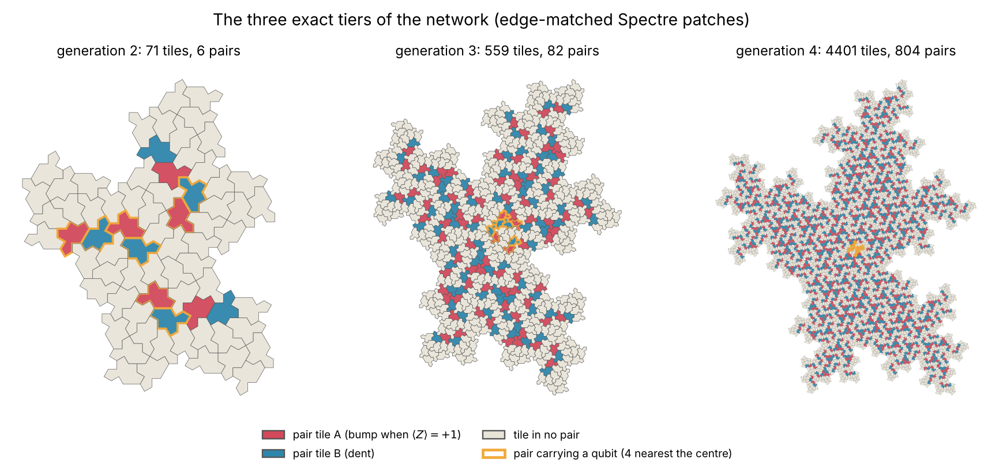 | **`fig_tiers.png`** The three exact tiers (71, 559, 4401 tiles; 6, 82, 804 pairs). Red and blue are the two tiles of a bump-and-dent pair, orange outlines the pairs that carry a qubit. |
| 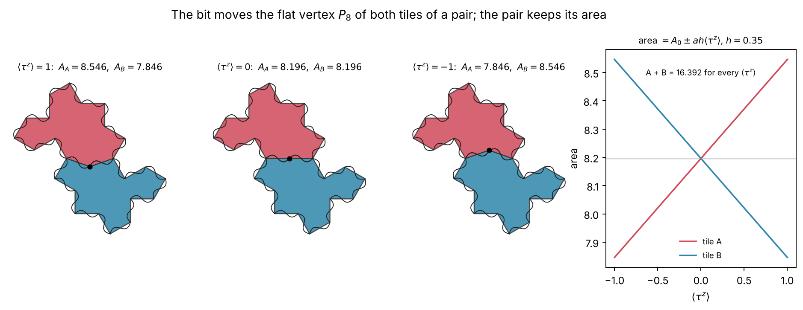 | **`fig_bit_geometry.png`** The bit moves the flat vertex `P8` of both tiles of a pair; their areas are `A0 +- a h <tau^z>` and the pair keeps its area. |
| 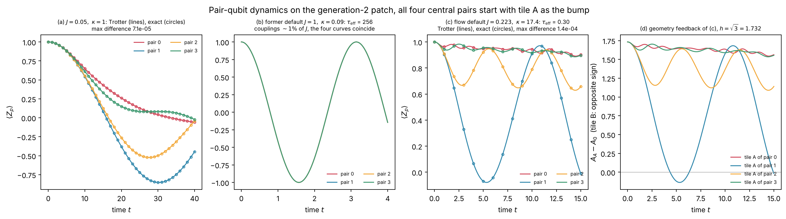 | **`fig_dynamics.png`** Trotter evolution against exact diagonalisation on four pairs, the default weak-coupling scale, and the area feedback. |
| 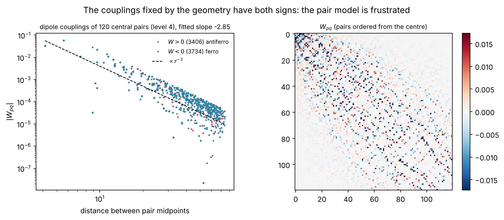 | **`fig_couplings.png`** Dipole couplings `W_pq` of 120 central pairs of generation 4: both signs, falling roughly as `r^-3` (fitted slope about -2.85). |
| 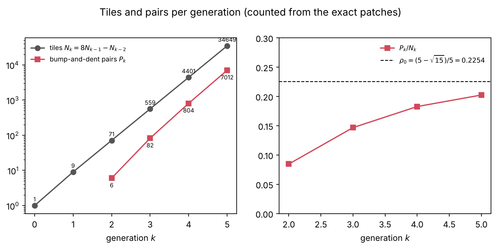 | **`fig_pair_counts.png`** Tiles and pairs per generation (1 to 34649; 6 to 7012) and `P_k/N_k` rising toward `rho_0 = (5 - sqrt(15))/5 = 0.2254`. |

### Entanglement figures (Stages 2 and 4)

`python3 make_figures_entanglement.py` (about 15 s) draws two more into `figures/`.

| Figure | Shows |
| :--- | :--- |
| 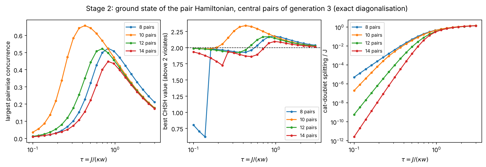 | **`fig_stage2_tau_scan.png`** Largest pairwise concurrence, best CHSH value and cat-doublet splitting against `tau` for 8 to 14 central pairs of generation 3. The concurrence peak and the Bell violation do not survive growth in size. |
| 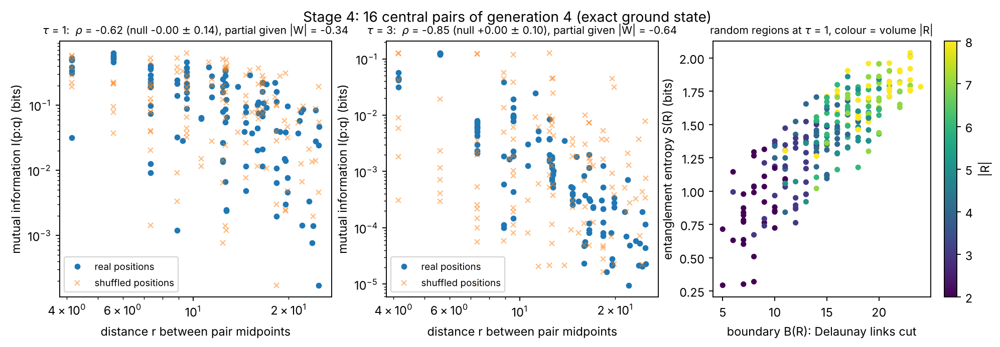 | **`fig_stage4_geometry.png`** 16 central pairs of generation 4: mutual information against distance at `tau` = 1 and 3 with the shuffled-position control, and the entropy of random regions against the boundary they cut. |

### 3D figures

`python3 make_figures_3d.py` (about 2 minutes) draws four more into `figures/`.

| Figure | Shows |
| :--- | :--- |
| 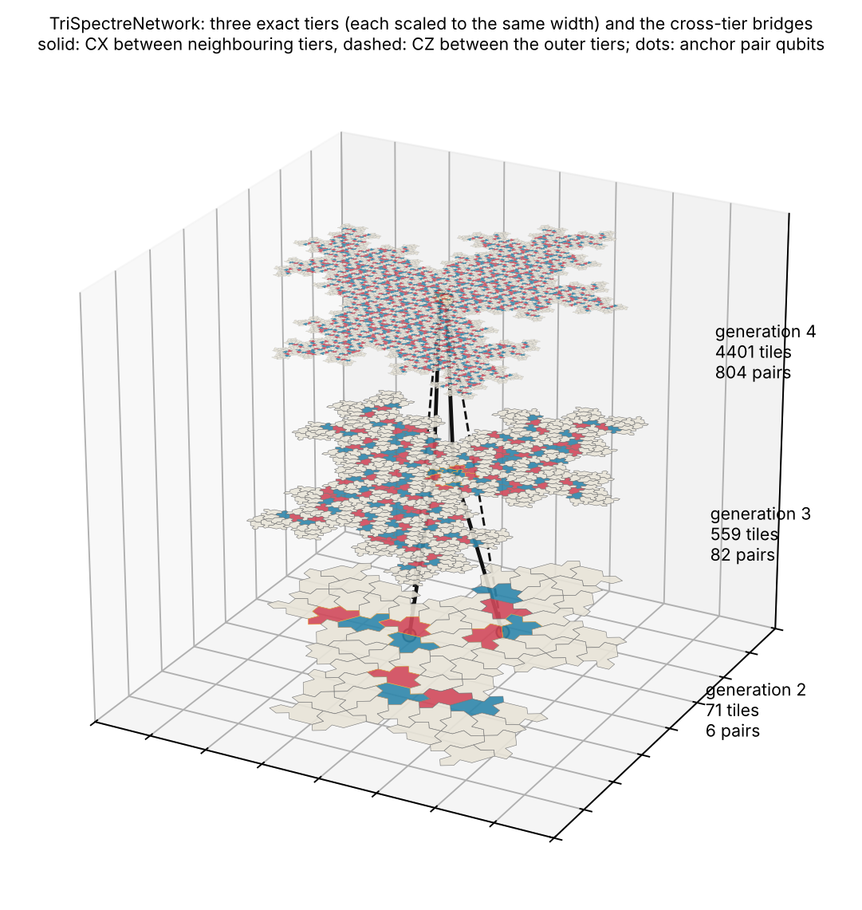 | **`fig3d_tier_stack.png`** The three tiers as stacked planes (each scaled to the same width, so sizes are not to scale) with the CX and CZ bridges of `entangle_across_computers` drawn between the anchor pair qubits. |
| 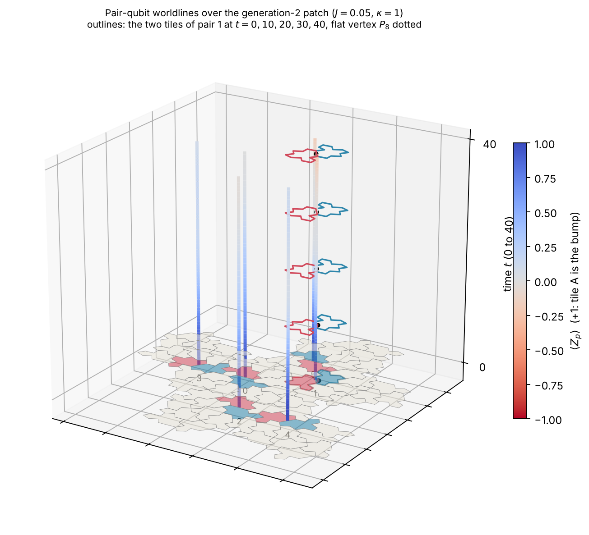 | **`fig3d_spacetime.png`** Time as the vertical axis: a worldline per pair qubit over the generation-2 patch, coloured by `<Z_p>`, with the two tiles of one pair outlined at five times. The `P8` displacement is small at this `h`, so the outlines change little. |
| 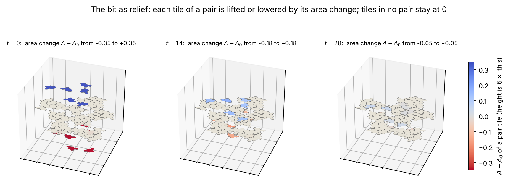 | **`fig3d_area_relief.png`** The bit as relief: each tile of a pair is lifted or lowered by its area change `A - A0` at three times; tiles in no pair stay at 0. |
| 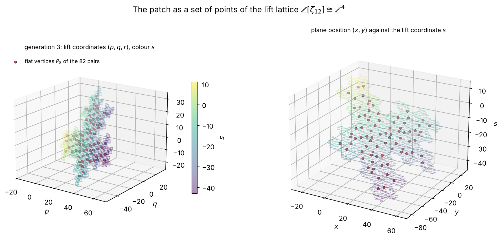 | **`fig3d_lift.png`** The generation-3 patch as points of the lift lattice `Z[zeta_12] = Z^4` (left: coordinates `p, q, r`, colour `s`; right: plane position against `s`), with the 82 flat vertices marked. It shows how the 2D tiling sits inside the four-dimensional lattice; it does not draw the windows. |

**A caution from the dynamics figure.** The geometric couplings are small: `|W| <= 0.06` for the central pairs of generation 2, so with `J = 1` and `kappa = (a h)^2 = 0.09` they are about 1% of the tunnelling and the four pairs oscillate identically. The default network therefore behaves like independent qubits. The left and right panels use `J = 0.05`, `kappa = 1` (both are definitions of the model) to let the couplings act; whether a physical choice makes them comparable is an open modelling question (Roadmap, Stage 2).

---

## Substitution Table ($N_k = 8N_{k-1} - N_{k-2}$)

| Iteration ($k$) | Starting from 1 Single Spectre | Starting from 1 Mystic (2 tiles) | Role in `TriSpectreNetwork` |
| :---: | :---: | :---: | :--- |
| $k = 0$ | $1$ | $2$ | Seed monotile |
| $k = 1$ | $9$ | $8$ | no pair, so no tier |
| $k = 2$ | **$71$** | $62$ | **`QC-71`** (6 pairs) |
| $k = 3$ | **$559$** | $488$ | **`QC-559`** (82 pairs) |
| $k = 4$ | **$4{,}401$** | $3{,}842$ | **`QC-4401`** (804 pairs) |
| $k = 5$ | $34{,}649$ | $30{,}248$ | — |
| $k = 6$ | $272{,}791$ | $238{,}142$ | — |

---

## Installation & Requirements

Install the Python dependencies required by the simulator and geometry engine:

```bash
pip install numpy bitarray pyfunctional scipy matplotlib
```

* `numpy` & `matplotlib`: Used by `spectremodel.py` for Bezier evaluation, Gauss-Legendre exact area quadrature, and rendering; `matplotlib` also draws the figures.
* `scipy`: Sparse exact diagonalisation (`pair_hamiltonian.py`) and rank statistics and Delaunay links (`entanglement_geometry.py`).
* `bitarray` & `pyfunctional`: Used by `state.py` for immutable `frozenbitarray` basis keys and functional `seq` state transformations.

---

## Quick Start

### 1. Run Self-Tests on the Spectre Monotile Geometry
Verify that the editable Bezier tile model passes all geometric, twist, and exact-area checks:

```bash
python3 spectremodel.py --tests-only
```

### 2. Inspect the Three Exact Tiers (71, 559, 4401 Tiles)
Generate the generation 2, 3, 4 patches, find their bump-and-dent pairs (6, 82, 804) and bind pair-qubit indices to `vertex.data["qubit"]` and `tile.data["pair_qubit"]`; `--tests-only` checks tile counts, edge matching, pair counts and the area ledger:

```bash
python3 quantumspectremodel.py
python3 quantumspectremodel.py --tests-only
```

### 3. Run a Coupled Three-Computer Quantum-Geometry Cycle
Instantiate `QC-71`, `QC-559` and `QC-4401`, evolve the pair qubits under the dipolar transverse-field Hamiltonian, bridge anchor qubits across the tiers, and feed $\langle Z_p \rangle$ back into the areas of the two tiles of each pair (about 30 s; `--tests-only` checks the Trotter evolution against exact diagonalisation and the area ledger):

```bash
python3 tri_spectre_qc.py
python3 tri_spectre_qc.py --tests-only
```

### 4. Stage 2 and Stage 4: ground-state entanglement
Exact diagonalisation of the pair Hamiltonian, checked against the matrix-free `State` Trotter evolution, and the entanglement-geometry measurements (these need `scipy`; the figures need `matplotlib`; both are in `pyproject.toml`):

```bash
python3 pair_hamiltonian.py --tests-only      # 6 checks
python3 pair_hamiltonian.py 10                # tau scan on 10 central pairs
python3 entanglement_geometry.py --tests-only # 6 checks
python3 entanglement_geometry.py 12 14 16     # mutual information and area/volume fits
```

### Example Python Usage

```python
from tri_spectre_qc import TriSpectreNetwork

# Initialize the three coupled quantum computers (71, 559 and 4401 tiles)
network = TriSpectreNetwork(
    a=1.0,
    b=1.0,
    curve_strength=0.5,
    qubits_per_tier=(4, 4, 4),
    generations=(2, 3, 4),
)

# Run 3 coupled quantum-geometry feedback cycles
for step in range(3):
    network.step_coupled_cycle(dt=0.6, steps=3)
    print(f"=== Cycle {step + 1} ===")
    for row in network.summary():
        print(row)
```

---

See also [ROADMAP_QUANTUM_GRAVITY.md](ROADMAP_QUANTUM_GRAVITY.md) for the ordered plan and its stopping rules, and [SPECTRE_PHASON_FLIPS.md](SPECTRE_PHASON_FLIPS.md) for how phason flips of the tiling change the neighbour structure this network is built on.

## Future Directions & Extensions

* **Spectre to Hat deformation:** vary `a`, `b` and the corner angle along the Spectre-Hat flow (exact patches currently require `a = b = 1`), and let the flow set `h` and `J`.
* **Flips as dynamics:** re-assign qubits when a phason flip changes the pair structure (Roadmap, Stage 3).
* **Interactive Visualization:** Render `QC-71`, `QC-559` and `QC-4401` side-by-side with `matplotlib`, coloring pairs by $\langle Z_p \rangle$ and animating the Bezier boundary deformations across cycles.

# QWLA: Quantum computing without the linear algebra

<div align="center">
  
</div>
QWLA is a tiny quantum circuit simulator written in Python.
The goal of QWLA, as the title suggests, is to present quantum computing without using linear algebra.
Instead, QWLA represents a quantum state as a dictionary and applies operations in a functional style, using map, filter, reduce, etc.

## technical details
For all technical details and an introduction to quantum computing without the linear algebra, see the [accompanying paper](https://eprint.iacr.org/2025/1091.pdf).

## structure
- The `state.py` file contains the `State` class, which is a quantum state and supports a number of operations (Clifford + T).
- There are example circuits in the `examples/` folder.


## usage
The easiest way to use QWLA is with [uv](https://docs.astral.sh/uv/getting-started/installation/).
To run an example, simply:

```bash
uv run examples/epr.py
```

## citation

```
@misc{cryptoeprint:2025/1091,
      author = {Aws Albarghouthi},
      title = {Quantum Computing without the Linear Algebra},
      howpublished = {Cryptology {ePrint} Archive, Paper 2025/1091},
      year = {2025},
      url = {https://eprint.iacr.org/2025/1091}
}
```


